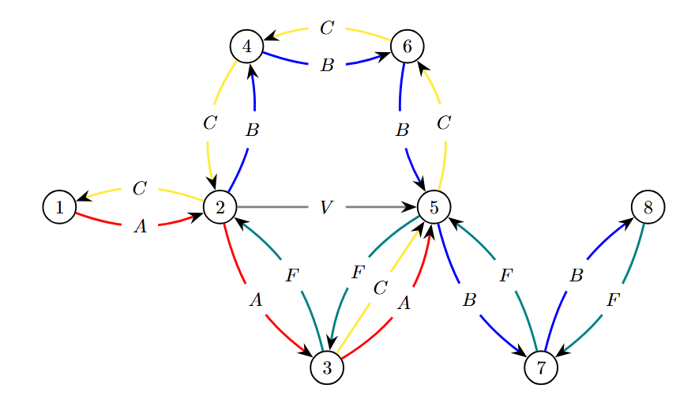
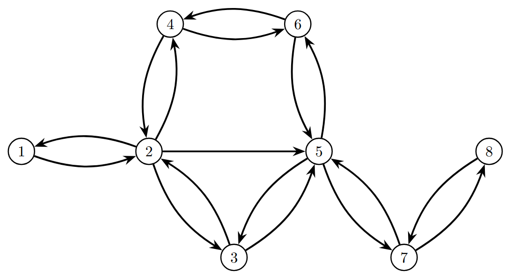
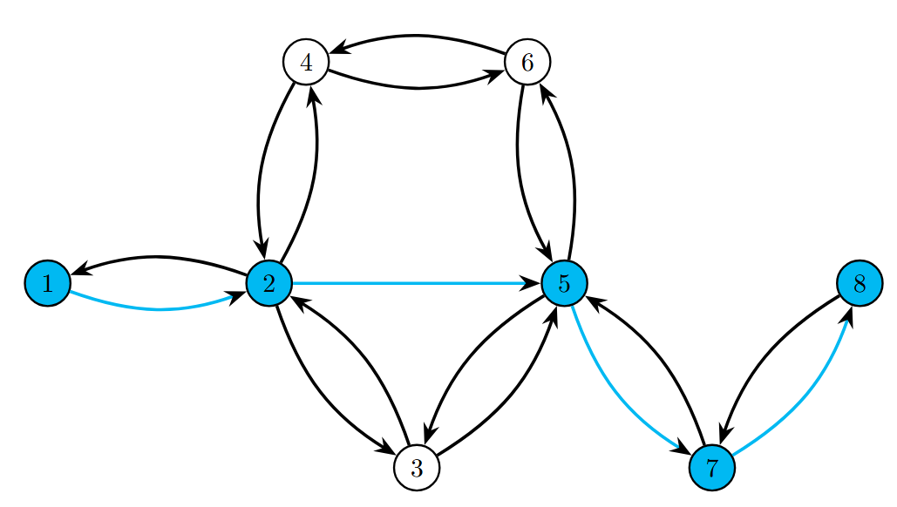
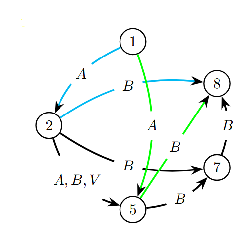
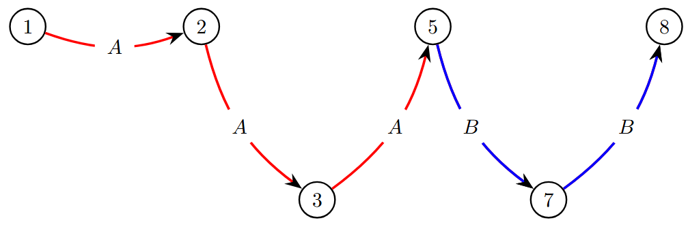
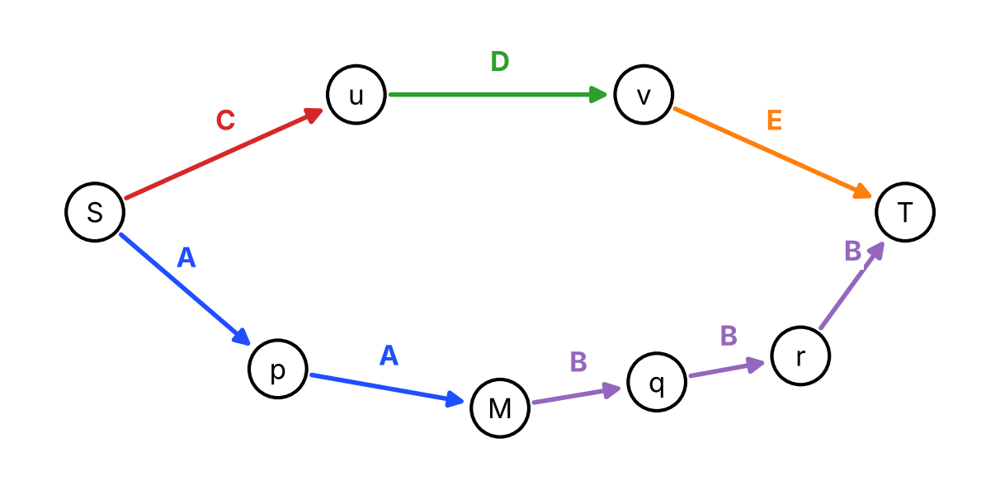

Qualche tempo fa, per puro divertimento, mi sono chiesto: *"dato un feed GTFS, come faccio a trovare il percorso in autobus con meno cambi tra due fermate?"*.
Il risultato è **BusFinder**, una piccola applicazione Java/Spring che implementa un'euristica per rispondere a questa domanda, accompagnata da un breve report in inglese. Questo post riprende quel report in italiano e, a distanza di tempo, ci aggiunge una cosa che nel report era solo accennata: **quanto è davvero buona questa euristica, e dove sbaglia**.

I dati con cui l'ho provata sono gli open data di **ACTV**, l'azienda di trasporto pubblico di Venezia, per le linee urbane. Il progetto è personale, ma spero possa essere un punto di partenza per chi vuole giocare con GTFS e con gli algoritmi su grafi.

**Indice**

* TOC
{:toc}

## 1. Che cos'è GTFS

**GTFS** (*General Transit Feed Specification*) è lo standard con cui le aziende di trasporto pubblico condividono orari e percorsi di autobus, treni, metro e così via. Nato in casa Google, oggi è usato da moltissime aziende nel mondo.

Un feed GTFS è un archivio zip di file CSV (con estensione `.txt`), ognuno dei quali è una "tabella" con uno scopo preciso:

| File | Contenuto |
|---|---|
| `agency.txt` | Informazioni sull'azienda: nome, sito, telefono, fuso orario |
| `routes.txt` | Le linee: nome, tipo di mezzo (bus, treno...), descrizione |
| `trips.txt` | Le singole corse di ogni linea |
| `stops.txt` | Le fermate: nome, coordinate, eventuale accessibilità |
| `stop_times.txt` | Orari di arrivo e partenza di ogni corsa a ogni fermata |
| `calendar.txt` | Giorni della settimana e periodo in cui il servizio è attivo |
| `calendar_dates.txt` | Eccezioni al calendario (es. servizio sospeso in un giorno festivo) |
| `shapes.txt` | La forma del percorso, come sequenza di coordinate GPS |

## 2. Perché GTFS non è comodo per calcolare percorsi

GTFS è ottimo per *descrivere* un servizio, ma non è stato pensato per fare calcoli come "trovami il percorso con meno cambi". Alcuni motivi:

* **Dati statici.** Il feed contiene orari programmati: non sa nulla di ritardi, guasti, deviazioni o traffico. Il percorso calcolato è quindi quello "teorico".
* **Complessità combinatoria.** In una rete con tante linee, fermate e possibili interscambi, il numero di itinerari tra due fermate cresce in fretta. Anche solo cercare quelli con pochi cambi obbliga a esplorare molte combinazioni di linee e fermate.
* **Tanti modi di cambiare.** Per passare da una linea all'altra ci sono spesso più fermate possibili, e dove si cambia influisce parecchio su tempi e comodità. Non basta contare i cambi, conta anche *dove* si fanno.
* **Serve un algoritmo su grafi.** Il problema si modella con un grafo (fermate come nodi, collegamenti come archi), ma i pesi degli archi dipendono da tipo di cambio, attese e altro. Dijkstra e A* funzionano bene per il percorso più breve, ma con vincoli sui cambi servono tecniche più avanzate (ricerca bidirezionale, k-shortest paths...).

## 3. L'idea: separare la topologia dalle linee

L'idea di fondo è spezzare il problema in due:

1. prima guardo **solo la topologia** della rete: quali fermate sono collegate tra loro, senza chiedermi da quale linea;
2. poi uso il percorso trovato come **scheletro** su cui "agganciare" le linee vere, cioè calcolare quali linee servono e dove cambiare.

In questo modo l'algoritmo non esplora tutte le combinazioni di linee dell'intera rete, ma solo quelle rilevanti per le fermate del percorso candidato. È un compromesso: **ci guadagno in semplicità e costo computazionale, ma perdo la garanzia di ottimalità**. Per questo parlo di *euristica*, e più avanti vedremo esattamente cosa si perde.

## 4. L'algoritmo passo per passo

### 4.1 Il grafo delle fermate

Modello la rete come un **grafo orientato**: le fermate sono i nodi, e c'è un arco da una fermata a un'altra se **almeno una linea** le collega direttamente. L'arco però è *anonimo*: non dice quale linea.


*Figura 1a - Esempio di rete di linee bus (A, B, C, F, V).*


*Figura 1b - Lo stesso grafo, tenendo solo le connessioni tra fermate.*

Questa scelta serve a isolare la struttura della rete e rende facile analizzarne le proprietà, ad esempio la *centralità* di una fermata (quanto è importante nel flusso complessivo) o le *componenti connesse* (zone isolate o molto collegate).

### 4.2 Il percorso minimo e gli "agganci"

Su questo grafo calcolo il **percorso minimo** tra fermata di partenza e di arrivo, contando solo il numero di archi (cioè di fermate attraversate). Le fermate che ne fanno parte diventano i nostri **agganci** (*hooks*).


*Figura 2a - Percorso minimo da 1 a 8: 1 → 2 → 5 → 7 → 8.*

Tieni a mente questo passaggio: da qui in poi **l'unico posto in cui potrò cambiare linea sono le fermate di questo percorso**. È la scelta che rende l'algoritmo veloce, ed è anche la sua principale debolezza.

### 4.3 Lo Shortest Transfer Graph (STG)

Partendo dal percorso minimo costruisco un secondo grafo, l'**STG** (*Shortest Transfer Graph*). I suoi nodi sono solo gli agganci, e questa volta gli archi sono **etichettati con le linee reali**. Per costruirlo:

1. prendo il primo nodo del percorso e, per ogni nodo successivo, controllo se esiste almeno una linea che collega direttamente le due fermate. Se sì, aggiungo l'arco etichettato con le linee che le collegano;
2. ripeto lo stesso procedimento per ogni nodo del percorso, fino al penultimo.

Un esempio: se il percorso minimo tra 1 e 5 è `P = {1, 2, 3, 4, 5}`, controllo i collegamenti `1→2, 1→3, 1→4, 1→5`, poi `2→3, 2→4, 2→5`, poi `3→4, 3→5` e infine `4→5`, aggiungendo un arco solo dove esiste una linea diretta.


*Figura 2b - STG per il percorso da 1 a 8. Gli archi colorati sono i due percorsi minimi tra 1 e 8.*

Con questa costruzione un arco dell'STG corrisponde a un tratto percorso **senza scendere dal bus**: gli archi sono "tratte" e i nodi in cui due tratte si incontrano sono i cambi.

### 4.4 Il percorso minimo nell'STG

A questo punto calcolo di nuovo il percorso minimo da partenza ad arrivo, ma stavolta **nell'STG**. Il numero di archi di questo percorso è il numero di tratte, quindi:

* se il percorso minimo ha lunghezza **1**, esiste una linea diretta e non serve nessun cambio (il caso migliore);
* altrimenti, il percorso trovato è quello con il **minor numero di cambi** tra gli agganci considerati.

Nell'esempio le due soluzioni evidenziate in Figura 2b sono `1 -A-> 2 -B-> 8` e `1 -A-> 5 -B-> 8`: in entrambi i casi un solo cambio. Quella mostrata in Figura 2c è la seconda: si prende la linea A da 1 a 5 (passando per 2 e 3) e poi la B da 5 a 8 (passando per 7).


*Figura 2c - Risultato: linea A da 1 a 5, cambio in 5, linea B da 5 a 8.*

## 5. Quanto è buona questa euristica?

Vediamo con precisione cosa garantisce e cosa no.

**Cosa garantisce.**

* Se esiste una **linea diretta** tra partenza e arrivo, la trova sempre: partenza e arrivo sono per costruzione nodi dell'STG, quindi l'arco diretto c'è.
* Il risultato è **sempre un itinerario valido**: ogni tratta è una vera linea che collega le due fermate nell'ordine giusto.
* Tra tutti gli itinerari che cambiano **solo nelle fermate del percorso minimo**, restituisce quello con meno cambi.

**Cosa non garantisce.** Non garantisce il numero minimo di cambi *in assoluto*. Il problema è nel passo 4.2: il percorso minimo conta le fermate, non i cambi, e un itinerario con meno cambi può passare per fermate completamente diverse.

Un controesempio piccolo (Figura 3). Ci sono cinque linee:

* la linea `A` va da S a p a M;
* la linea `B` va da M a q a r a T;
* le linee `C`, `D` ed `E` sono tre linee corte: `C` da S a u, `D` da u a v, `E` da v a T.


*Figura 3 - Il percorso con meno fermate (S, u, v, T) richiede 3 tratte; quello con meno cambi (S, p, M, q, r, T) ne richiede 2.*

Il percorso con meno fermate è `S → u → v → T` (3 archi, contro i 5 di quello passante per M). Gli agganci sono quindi solo `S, u, v, T`, e l'STG contiene soltanto gli archi `S -C-> u`, `u -D-> v`, `v -E-> T`: il risultato è un viaggio con **tre linee e due cambi**. Eppure `S -A-> M -B-> T` richiede **un solo cambio**, a M. L'euristica non lo vede perché M non è un aggancio.

In pratica quanto capita? Dipende dalla rete. In una rete urbana con linee lunghe che si sovrappongono molto, il percorso con meno fermate e quello con meno cambi tendono a coincidere spesso, ma non c'è nessuna garanzia, e per un uso serio andrebbe misurato su dati reali.

## 6. Aggiungere l'orario

Finora l'algoritmo ragiona solo su linee e fermate. Nell'applicazione l'ultimo passo è scegliere le **corse** concrete: dato l'orario di partenza, per ogni tratta dell'STG cerco, tra le linee candidate, quella che parte prima a partire da quell'ora. L'orario di arrivo alla fine della tratta diventa l'orario minimo di partenza della tratta successiva.

Attenzione: questo è un filtro *greedy* applicato alla fine. Il numero di cambi è già deciso prima di guardare gli orari, quindi l'algoritmo non confronta mai, per esempio, "un cambio con 40 minuti di attesa" contro "due cambi che arrivano prima".

## 7. BusFinder: l'implementazione

L'applicazione è scritta in **Java con Spring** e l'ho pensata come banco di prova per l'euristica. I pezzi principali sono:

* **Loader dei dati.** Una procedura automatica carica i file `.txt` del feed GTFS in un database, così non serve toccare i CSV a mano. Il caricamento completo è lento (una versione più veloce si potrebbe fare, ma non mi andava :-D), ma si fa solo la prima volta.
* **Il cuore dell'algoritmo**, che nel codice segue esattamente i passi visti sopra:

```java
// 1. percorso minimo sul grafo delle fermate
List<Integer> sp = gdm.shortestPath(startStopId, endStopId);
sp.addFirst(startStopId);

// 2. costruzione dello Shortest Transfer Graph sugli "agganci"
GraphModel stg = initSTG(sp);

// 3. percorso minimo nell'STG = percorso con meno cambi
List<Integer> stgShortestPath = stg.shortestPath(startStopId, endStopId);
```

* **Un endpoint REST** per provarlo:

```
http://localhost:8080/algo?start=4594&end=461&deptime=12:00:00
```

I parametri sono l'ID della fermata di partenza (`start`), quello della fermata di arrivo (`end`) e l'orario di partenza in formato `HH:MM:SS` (`deptime`). La risposta è un JSON con una lista di `steps`, uno per ogni tratta, con linea, fermate e orari. Per la richiesta di sopra, ad esempio:

| Tratta | Linea | Da | A | Partenza | Arrivo |
|---|---|---|---|---|---|
| 1 | A | Faro Rocchetta | Santa Maria Elisabetta | 12:13 | 12:32 |
| 2 | A | Santa Maria Elisabetta | San Nicolo' Chiesa | 12:41 | 12:53 |

Curiosità: le due tratte hanno entrambe il nome "A", ma in GTFS sono due `route_id` distinti (21 e 10), quindi per l'algoritmo c'è un cambio.

Per provarlo basta scaricare i dati GTFS di [ACTV](https://actv.avmspa.it/sites/default/files/attachments/opendata/automobilistico/) (o di qualunque altra azienda), indicare la cartella e i nomi dei file in `db_loader.properties`, e al primo avvio attivare il caricamento nel database. Tutti i dettagli sono nel README della repo.

## 8. Limiti e cose da sistemare

Rileggendo il progetto con calma, questo è l'elenco onesto di ciò che non va o che manca.

**Dell'algoritmo**

* **Non è ottimale** nel numero di cambi, come visto nel controesempio della sezione 5.
* **Il numero di cambi viene deciso prima degli orari**: nessun confronto tra tempo di attesa e numero di cambi (sezione 6).
* **Si conta il numero di fermate, non il tempo di viaggio**, quindi due percorsi con lo stesso numero di fermate sono trattati come equivalenti.

**Del modello dati**

* **Una corsa "rappresentante" per linea.** La sequenza di fermate di una linea viene ricavata dalla prima corsa di quella linea. Varianti di percorso, corse che saltano fermate o che terminano prima del capolinea non sono modellate.
* **Calendario ignorato.** I file `calendar.txt` e `calendar_dates.txt` finiscono nel database, ma la ricerca non li usa: non distingue tra feriale, festivo o giorni di sospensione.
* **Dati statici**, come per qualunque uso di GTFS "classico": niente ritardi né informazioni in tempo reale.

**Del codice**

* Il percorso minimo sul grafo delle fermate usa un Dijkstra con scansione lineare (costo quadratico nel numero di nodi) su un grafo *non pesato*: una semplice **BFS** farebbe lo stesso lavoro in tempo lineare.
* La lista di nodi restituita dalla cache dei percorsi minimi viene modificata sul posto (`addFirst`), cosa fragile.
* Se dopo l'orario richiesto non ci sono corse, il codice non gestisce il caso e va in errore (`NullPointerException`) invece di rispondere "nessun percorso".

## 9. Alternative e sviluppi futuri

Se dovessi ripartire oggi:

* **BFS sul grafo delle linee.** Invece di avere le fermate come nodi, uso le linee: due linee sono collegate se hanno una fermata in comune (e in un ordine compatibile con il senso di marcia). Una BFS su questo grafo trova il numero minimo di tratte senza dipendere da un percorso candidato scelto prima, quindi risolve il problema del controesempio.
* **RAPTOR.** È un algoritmo pensato proprio per questo problema: procede a "round", dove al round *k* si trovano gli arrivi migliori usando al massimo *k* tratte. Gestisce nativamente gli orari e restituisce l'insieme di soluzioni migliori tra tempo di arrivo e numero di cambi. Sarebbe il confronto naturale per misurare quanto sbaglia la mia euristica sui dati reali.
* **Pesare gli archi dell'STG** con i tempi di percorrenza, per ottimizzare anche la durata del viaggio.
* **Usare il calendario** per filtrare le corse attive nel giorno richiesto.

## Conclusioni

Quello che era partito come "vediamo se riesco a trovare i cambi minimi con GTFS" è diventato un'euristica semplice, che sfrutta un trucco di fondo: ragionare prima sulla struttura della rete e solo dopo sulle linee. Non pretende di essere l'algoritmo migliore, e come abbiamo visto in alcuni casi sbaglia, ma è facile da capire, da implementare e da estendere, e secondo me è un buon punto di partenza per chi vuole sperimentare con GTFS.

La repo con il codice e il report originale (in inglese) è qui:

- [BusFinder](https://github.com/luckyluke98/BusFinder) - applicazione Spring con loader GTFS ed endpoint di prova
- [Report: A Heuristic for Minimizing Transfers in Bus Routes Modeled with GTFS](https://github.com/luckyluke98/BusFinder/blob/master/A_Heuristic_for_Minimizing_Transfers_in_Bus_Routes_Modeled_with_GTFS__English_.pdf)

Se avete domande o suggerimenti, scrivetemi pure.

## Fonti

- [GTFS Static Reference](https://gtfs.org/documentation/schedule/reference/) - specifica ufficiale dei file GTFS
- [ACTV - Open data (servizio automobilistico)](https://actv.avmspa.it/sites/default/files/attachments/opendata/automobilistico/) - i dati usati per i test
- D. Delling, T. Pajor, R. Werneck, *Round-Based Public Transit Routing* - l'articolo che introduce RAPTOR
