Negli ultimi mesi mi sono dedicato a uno studio approfondito di **SMB1** e di come al suo interno viaggia l'autenticazione **NTLM**. Non un'analisi "ad alto livello" presa da qualche slide, ma uno smontaggio byte per byte dei pacchetti scambiati tra client e server, fino a scrivere dei parser in **C** che li decodificano da zero.

Questo post mette insieme il lavoro fatto in diverse repo (gli appunti di studio, i parser e un server di validazione) in un unico percorso: da NetBIOS fino all'ultimo byte del blob NTLMSSP.

> Lo studio è nato per capire davvero come funziona l'autenticazione NTLM su SMB1, a livello di red teaming/offensive security e di didattica del protocollo. Tutto il codice è pensato per essere usato in ambienti autorizzati.

## 1. Il trasporto: NetBIOS e SMB

Prima di arrivare ai pacchetti SMB veri e propri, c'è da capire su cosa viaggiano. **NetBIOS** è un vecchio "modo" per far parlare tra loro i computer in una LAN, prima che DNS e TCP/IP diventassero lo standard. Forniva tre cose fondamentali:

1. **Un nome** al computer, risolto in broadcast sulla rete (non DNS).
2. **La possibilità di trovare altri host** tramite broadcast ("Chi si chiama PC-MARIO?" → "Sono io").
3. **Una sessione** sopra cui far viaggiare messaggi applicativi - ed è proprio sopra questa sessione che viaggia SMB.

Con l'arrivo di TCP/IP, Microsoft ha fatto girare NetBIOS sopra TCP/UDP, e oggi è sostanzialmente ridondante ma mantenuto per retrocompatibilità. Il risultato è che SMB oggi può viaggiare in due modi:

| Servizio | Porta | A cosa serve |
|---|---|---|
| NetBIOS Name | UDP 137 | Risoluzione nomi in broadcast |
| NetBIOS Datagram | UDP 138 | Messaggi broadcast/datagram |
| NetBIOS Session | TCP 139 | Trasporto SMB **dentro** NetBIOS |
| SMB diretto | TCP 445 | SMB **senza** NetBIOS |

Nel caso di **Direct TCP** (porta 445), ogni messaggio SMB **DEVE** essere preceduto da un'intestazione di trasporto di 4 byte:

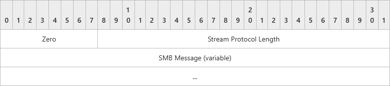

- **Zero** (1 byte): DEVE essere `0x00`.
- **Lunghezza del protocollo di flusso** (3 byte): la lunghezza, in byte, del messaggio SMB che segue, codificata come intero a 3 byte in network byte order. Non include questi stessi 4 byte di header. Se il valore supera `0x1FFFF`, il server DOVREBBE disconnettere la connessione.

È un dettaglio minimo ma fondamentale quando si scrive un parser: bisogna prima bufferizzare questi 4 byte, poi sapere quanti byte aspettarsi per il messaggio completo - esattamente il meccanismo di buffering che ho implementato in `smb1_parser` e in `impostor` (lo vediamo più avanti).

## 2. Il pacchetto SMB1

SMB1 (noto anche come **CIFS**) è un protocollo binario con specifiche e strutture **fisse** per richieste e risposte, diviso in tre blocchi dinamici: `SMB_Header`, `SMB_Parameters`, `SMB_Data`.

I primi 4 byte di qualsiasi pacchetto SMB dicono subito con che versione si ha a che fare:

- `0xFF 'S' 'M' 'B'` → **SMB1**
- `0xFE 'S' 'M' 'B'` → **SMB2**

(Tra SMB1 e SMB2 cambia completamente la struttura del pacchetto: SMB2 ha un header fisso a 64 byte e una struttura per-messaggio sempre fissa, con padding a 8 byte. SMB1 invece è tutto più "dinamico" - WordCount e ByteCount variabili. In questo studio mi concentro su SMB1/CIFS perché è il terreno su cui gira NTLM in modo più diretto da intercettare.)

> **Riferimenti e approfondimenti:**
> - [\[MS-CIFS\]](https://learn.microsoft.com/en-us/openspecs/windows_protocols/ms-cifs) - specifica base di CIFS/SMB1 (header, WordCount, ByteCount, dialetti "archeologici").
> - [\[MS-SMB\]](https://learn.microsoft.com/en-us/openspecs/windows_protocols/ms-smb) - estensioni per `NT LM 0.12`, inclusa la Extended Security.
> - [\[MS-SMB2\]](https://learn.microsoft.com/en-us/openspecs/windows_protocols/ms-smb2/) - specifica di SMB2.

### 2.1 SMB_Header (32 byte fissi)

L'header ha dimensione fissa, sempre 32 byte:

```c
SMB_Header {
    UCHAR  Protocol[4];
    UCHAR  Command;
    SMB_ERROR Status;
    UCHAR  Flags;
    USHORT Flags2;
    USHORT PIDHigh;
    UCHAR  SecurityFeatures[8];
    USHORT Reserved;
    USHORT TID;
    USHORT PIDLow;
    USHORT UID;
    USHORT MID;
}
```

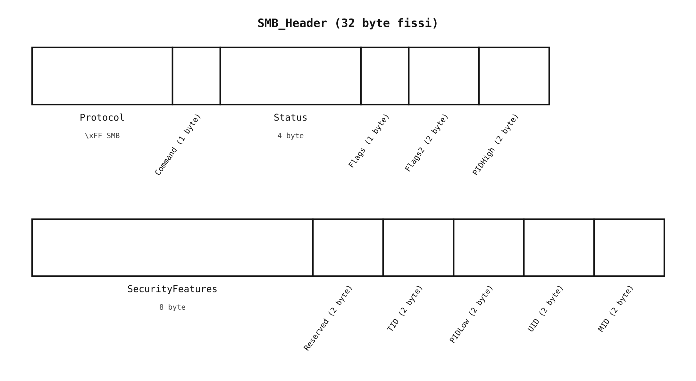

I campi che contano di più per il nostro scopo:

- **Protocol** (4 byte): la stringa letterale `'\xFF', 'S', 'M', 'B'`.
- **Command** (1 byte): il codice del comando ([lista completa dei comandi SMB1](https://learn.microsoft.com/en-us/openspecs/windows_protocols/ms-cifs/32b5d4b7-d90b-483f-ad6a-003fd110f0ec); `0x72` = NEGOTIATE, `0x73` = SESSION_SETUP_ANDX, ecc.).
- **Flags2** (2 byte): bit flag, tra cui `SMB_FLAGS2_EXTENDED_SECURITY` - è questo bit che segnala l'uso dell'autenticazione estesa (NTLMSSP) invece del vecchio schema LM.
- **SecurityFeatures** (8 byte): in caso di SMB signing contiene una firma di 8 byte; su trasporto connectionless ha un'altra interpretazione (Key/CID/SequenceNumber). Non ci interessa direttamente per l'intercettazione NTLM.
- **TID / PIDLow / UID / MID**: identificatori di tree, processo, utente e multiplexing - servono a correlare richieste e risposte sulla stessa connessione.

### 2.2 Parameter Block e Data Block

Dopo l'header fisso vengono due blocchi a struttura variabile, il cui contenuto dipende dal comando:

```
SMB_Parameters {
   UCHAR  WordCount;
   USHORT Words[WordCount] (variable);
}
```

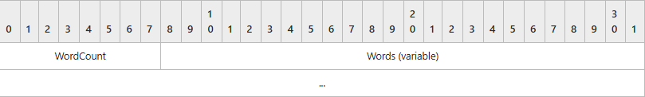

- **WordCount** (1 byte): la dimensione, in parole da 2 byte, del campo `Words`. Può essere zero.
- **Words** (variabile): la struttura specifica del comando, di dimensione `2 × WordCount` byte.

```
SMB_Data {
   USHORT ByteCount;
   UCHAR  Bytes[ByteCount] (variable);
}
```

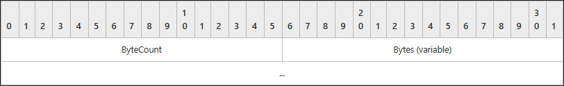

- **ByteCount** (2 byte): la dimensione in byte del campo `Bytes`. Può essere zero.
- **Bytes** (variabile): i dati specifici del comando - è qui, ad esempio, che viaggia il `SecurityBlob`.

Nota implementativa: poiché l'header è 32 byte (dispari rispetto all'allineamento a 2 byte) e `WordCount` è 1 byte, il campo `Words` che segue risulta **non allineato** in memoria - un dettaglio da tenere a mente scrivendo un parser in C che fa casting diretto su buffer.

### 2.3 Dialetti e negoziazione

In SMB un **dialetto** è una variante negoziabile del protocollo: definisce formato dei messaggi, comandi supportati e semantica. Nel pacchetto `SMB_COM_NEGOTIATE` (`0x72`) - il primo scambiato su ogni connessione SMB, e l'UNICO ammesso per connessione (richieste successive DEVONO essere rifiutate) - il client propone una lista di dialetti supportati, in ordine di preferenza crescente:

```
PC NETWORK PROGRAM 1.0
LANMAN1.0
Windows for Workgroups 3.1a
NT LM 0.12
```

Ogni voce della lista ha questo formato:

```
SMB_Dialect {
   UCHAR      BufferFormat;
   OEM_STRING DialectString;
}
```

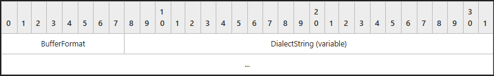

- **BufferFormat** (1 byte): DEVE essere `0x02` - indicatore che il campo seguente è un array di caratteri null-terminated.
- **DialectString** (variabile): la stringa del dialetto, null-terminated.

`NT LM 0.12` è, di fatto, la "lingua franca" di SMB1 oggi: è il minimo comune denominatore che qualsiasi client Windows moderno (anche con SMB1 abilitato solo per retrocompatibilità) userà per negoziare con un server legacy - dialetti come `LANMAN` o `PC NETWORK` sono reperti archeologici che nessun client Windows userebbe mai per scambiare credenziali, perché privi delle estensioni di sicurezza necessarie. Quando si parla di SMB1 oggi, ci si riferisce quasi sempre a `NT LM 0.12` (storicamente associato anche al nome commerciale **CIFS**).

Il server risponde con un `SMB_COM_NEGOTIATE` Response. Il `WordCount` della risposta è variabile finché non si sa quale dialetto è stato scelto; il primo campo DEVE sempre essere `DialectIndex` (l'indice, a partire da `0x0000`, del dialetto scelto nella lista; `0xFFFF` se nessuno è supportato). Se il dialetto negoziato è `NT LM 0.12`, la struttura si espande così:

```
SMB_Parameters {
   UCHAR  WordCount;
   Words {
     USHORT   DialectIndex;
     UCHAR    SecurityMode;
     USHORT   MaxMpxCount;
     USHORT   MaxNumberVcs;
     ULONG    MaxBufferSize;
     ULONG    MaxRawSize;
     ULONG    SessionKey;
     ULONG    Capabilities;
     FILETIME SystemTime;
     SHORT    ServerTimeZone;
     UCHAR    ChallengeLength;
   }
}

SMB_Data {
   USHORT ByteCount;
   Bytes {
     GUID ServerGUID;
     UCHAR  SecurityBlob[];
   }
}
```

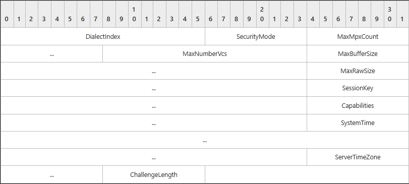

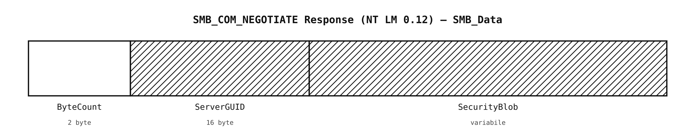

Il campo che ci interessa davvero è l'ultimo: **SecurityBlob** (variabile), un BLOB che dovrebbe contenere un token di autenticazione prodotto dal protocollo GSS - ed è esattamente il punto in cui finisce SMB "puro" e inizia il mondo ASN.1/SPNEGO/NTLMSSP che vediamo nel resto del post. **ServerGUID** (16 byte), invece, identifica univocamente il server (non va usato come metodo sicuro di identificazione, essendo falsificabile).

> **Riferimenti e approfondimenti:** [SMB_COM_NEGOTIATE (sezione 2.2.4.52), \[MS-CIFS\]](https://learn.microsoft.com/en-us/openspecs/windows_protocols/ms-cifs/96ccc2bd-67ba-463a-bb73-fd6a9265199e) · [SMB_COM_NEGOTIATE, \[MS-SMB\]](https://learn.microsoft.com/en-us/openspecs/windows_protocols/ms-smb/d883d0a5-5a0a-4626-8e3e-87b0b66b79aa)

Ed è lì, nel `SecurityBlob`, che inizia la parte interessante.

## 3. L'handshake NTLM sopra SMB1

Il flusso di autenticazione, nel caso tipico con **Extended Security** attiva, segue 5 passi. Ecco una cattura reale (Wireshark) dello scambio completo, dai 6 pacchetti che contano:

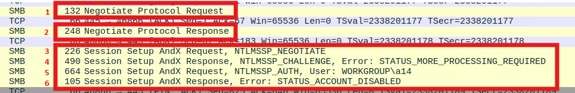

**1. Negotiate Protocol Request.** Il client invia un pacchetto SMB1 al server per dire che vuole connettersi, indicando nel body i dialetti che supporta:

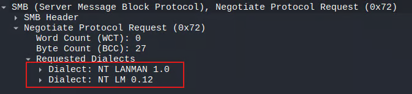

**2. Negotiate Protocol Response.** Il server risponde selezionando il dialetto scelto (qui `Selected Index: 1` → `NT LM 0.12`). Nel body, nel campo `SecurityBlob`, c'è un blob codificato in **ASN.1** che segnala che il meccanismo di negoziazione è **SPNEGO** (OID `1.3.6.1.5.5.2`): al suo interno (`negTokenInit` → `mechTypes`) il server propone i meccanismi di autenticazione supportati - in questo caso Kerberos (in varie forme) e **NTLMSSP** (`1.3.6.1.4.1.311.2.2.10`):

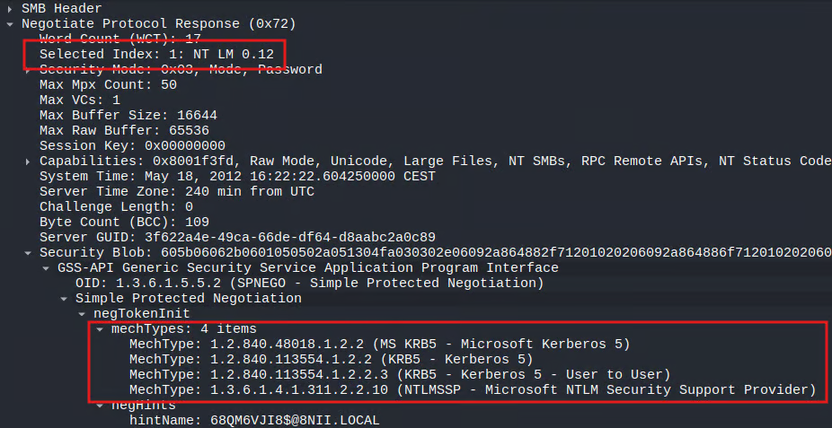

Il contenuto del `SecurityBlob` resta uguale tra SMB1 e SMB2: cambia solo l'involucro SMB che lo trasporta.

**3. Session Setup AndX Request (`0x73`), NTLMSSP_NEGOTIATE.** Il client risponde con un `Session Setup AndX Request`: nel `SecurityBlob`, sempre in ASN.1/SPNEGO, questa volta `mechTypes` contiene **un solo** OID (quello scelto, NTLMSSP) e nel campo `mechToken` c'è la prima parte dell'autenticazione NTLM vera e propria - un blob che **non** è più codificato in ASN.1, ma segue direttamente la struttura **NTLMSSP** (`NTLM Message Type: NTLMSSP_NEGOTIATE`, flag di negoziazione, ecc.):

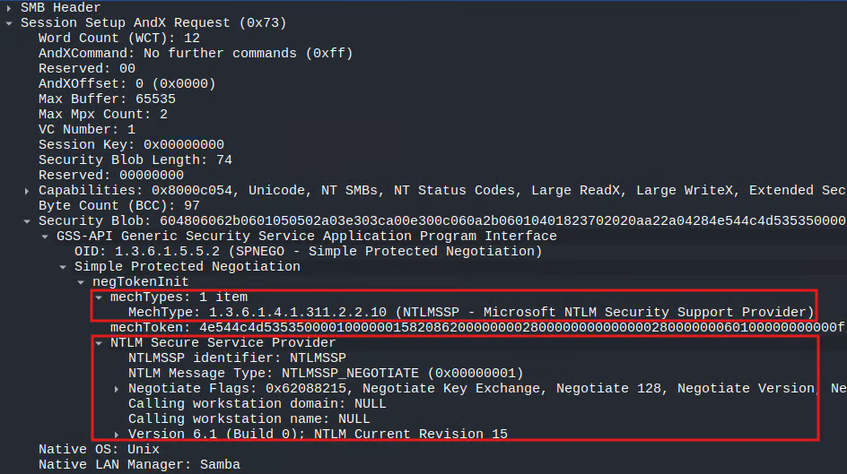

**4. Session Setup AndX Response (`0x73`), NTLMSSP_CHALLENGE.** Il server risponde con un altro `Session Setup AndX`, nel quale - come nella request del client - il `SecurityBlob` ha ancora l'involucro ASN.1/SPNEGO (ma ora `negTokenTarg`/`negState: accept-incomplete`), e al suo interno il `responseToken` contiene il body della challenge NTLM (`NTLMSSP_CHALLENGE`), non più in ASN.1: qui compaiono l'`NTLM Server Challenge` (8 byte) e il `Target Info` con i dettagli del dominio/host del server:

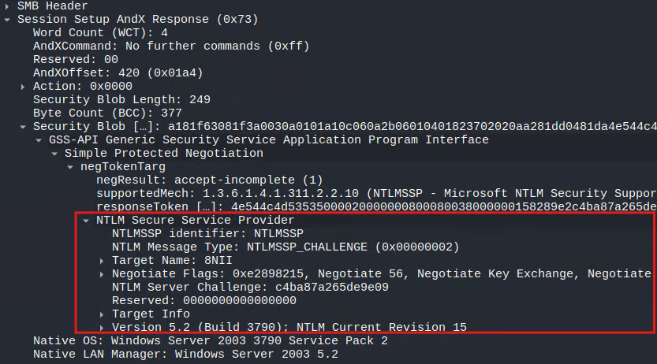

**5. Session Setup AndX Request (`0x73`), NTLMSSP_AUTH.** Il client chiude lo scambio con un ultimo `Session Setup AndX Request`, nel quale è presente la challenge firmata: `NTLM Message Type: NTLMSSP_AUTH`, con `LM Response`, `NTLMv2 Client Challenge`, `NTLM Response` (che include la NTLMv2 response usata per il cracking offline), `Domain name`, `User name`, `Host name` e il `MIC` finale:

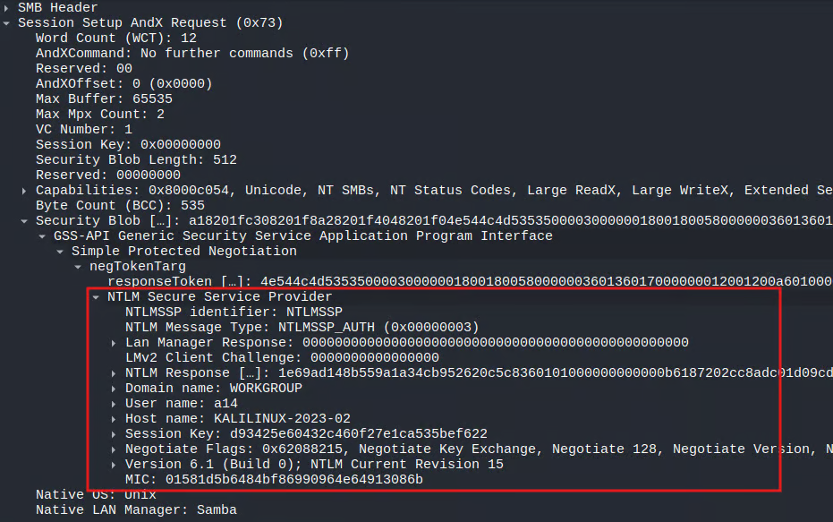

Nella cattura di esempio, dopo questo scambio il server risponde con `STATUS_ACCOUNT_DISABLED` (l'utente di test usato non è abilitato) - ma a questo punto, dal punto di vista dell'intercettazione, non importa: tutto il materiale NTLMv2 necessario (username, dominio, hostname, server challenge, NTLM response) è già transitato in chiaro sulla rete, dentro il pacchetto 5.

Il punto chiave di tutto lo scambio è che dentro il `SecurityBlob` convivono **due mondi diversi**: una parte codificata in ASN.1 (GSSAPI/SPNEGO) e una parte che, a un certo punto, "esce" da ASN.1 ed è codificata secondo NTLMSSP, in little-endian. Nei prossimi paragrafi vediamo perché, ed entriamo byte per byte in entrambi i livelli.

## 4. ASN.1 DER: il linguaggio sotto SPNEGO

**ASN.1** è un linguaggio che descrive strutture dati, ma non dice come serializzarle in byte: per quello servono le **Encoding Rules**. Nel nostro caso, i blob di sicurezza SMB usano **DER** (Distinguished Encoding Rules), un sottoinsieme stretto di BER che garantisce una codifica unica e deterministica.

Il formato di trasferimento è sempre **TLV** (Tag, Length, Value):

```
+-------------------------------+
|   |   +---------------------+ |
|   |   |   |   +-----------+ | |
| T | L | T | L | T | L | V | | |
|   |   |   |   +-----------+ | |
|   |   +---------------------+ |
+-------------------------------+
```

- **Tag**: il tipo della struttura (classe + numero).
- **Length**: in forma breve se ≤ 127 byte (1 byte, bit più significativo a 0), in forma lunga se ≥ 128 byte (il bit più significativo a 1 indica quanti byte successivi codificano la lunghezza vera).
- **Value**: il contenuto - che a sua volta può essere un altro TLV, se il tipo è "constructed" (es. una `SEQUENCE`).

Alcuni tag ricorrenti nei blob SMB: `0x30` (SEQUENCE), `0x06` (OBJECT IDENTIFIER), `0x04` (OCTET STRING - il punto in cui, come vedremo, ASN.1 "muore" e inizia NTLMSSP).

> **Riferimenti e approfondimenti:**
> - [Introduction to ASN.1 Syntax and Encoding](https://learn.microsoft.com/en-us/windows/win32/seccertenroll/about-introduction-to-asn-1-syntax-and-encoding)
> - [Encoded Tag Bytes](https://learn.microsoft.com/en-us/windows/win32/seccertenroll/about-encoded-tag-bytes)
> - [DER Transfer Syntax](https://learn.microsoft.com/en-us/windows/win32/seccertenroll/about-der-transfer-syntax)
> - [Encoded Length and Value Bytes](https://learn.microsoft.com/en-us/windows/win32/seccertenroll/about-encoded-length-and-value-bytes)
> - [DER Encoding of ASN.1 Types](https://learn.microsoft.com/en-us/windows/win32/seccertenroll/about-der-encoding-of-asn-1-types)
> *(fonte: Microsoft Learn)*

Per esercitarmi su questo ho scritto **[asn1_parser](https://github.com/lcky00/asn1_parser)**, un parser DER minimale in C che costruisce un albero navigabile dei nodi, con tanto di logger per stampare la struttura annidata:

```c
asn1_tree_t tree;
asn1_parser_error_t res = parse(buffer, buffer_len, &tree);

if (res < PARSER_OK) {
    printf("Error: 0x%x\n", res);
    return 1;
}

dump_asn1_tree(tree);
asn1_tree_free(&tree);
```

## 5. Il modello a cipolla: GSSAPI → SPNEGO → NTLMSSP

Il modo più utile che ho trovato per visualizzare il `SecurityBlob` è come una matrioska a tre livelli:

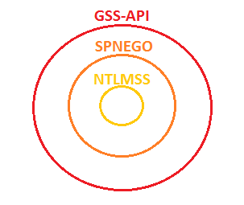

1. **GSSAPI (Initial Token)** - la "busta" standardizzata, in ASN.1 DER, che dice all'applicazione: *attenzione, questo è un token di negoziazione*.
2. **SPNEGO (`negTokenInit` / `negTokenResp`)** - anch'esso ASN.1 DER, contiene la lista dei meccanismi supportati (gli OID) e lo stato della negoziazione.
3. **Il payload del meccanismo scelto (NTLMSSP)** - da qui ASN.1 finisce: il payload è incapsulato in un **Octet String** (`0x04`), e da quel byte in poi si passa alle regole specifiche di NTLMSSP, in **little-endian**.

Perché serve SPNEGO? Perché client e server potrebbero supportare meccanismi diversi (Kerberos, NTLM...): **GSSAPI** ([RFC 2743](https://datatracker.ietf.org/doc/html/rfc2743)) fornisce l'interfaccia standard per gestire la sicurezza senza conoscere i dettagli del meccanismo specifico, mentre **SPNEGO** ([RFC 4178](https://datatracker.ietf.org/doc/html/rfc4178)) è lo "pseudo-meccanismo" che permette di negoziare in sicurezza quale meccanismo reale usare.

I due tipi di token SPNEGO principali sono:

- **`NegTokenInit`** (tag `0xa0`): propone i meccanismi (`mechTypes`), eventuali flag di contesto (`reqFlags`), un token "ottimistico" (`mechToken`) e un MIC per l'integrità.
- **`NegTokenResp`** (tag `0xa1`): comunica lo stato della negoziazione (`negState`: `accept-completed`, `accept-incomplete`, `reject`), il meccanismo scelto (`supportedMech`, solo nella prima risposta) e il payload vero e proprio (`responseToken`).

Per decodificare questo layer ho scritto **[spnego_decoder](https://github.com/lcky00/spnego_decoder)**, una libreria C **zero-copy**: prende in input l'albero ASN.1 già costruito da `asn1_parser` e, invece di ricopiare i byte, popola una struttura con puntatori diretti ai nodi dell'albero - compreso il payload NTLM interno, pronto per il passo successivo.

## 6. Dentro i blob: le 4 fasi byte per byte

Mettendo insieme quanto visto finora, ecco com'è fatto ciascuno dei 4 blob di sicurezza scambiati nell'handshake.

**Fase 1 - `SMB_COM_NEGOTIATE` Response.** Il server apre con l'header GSS-API (`0x60`), seguito dall'OID SPNEGO (`1.3.6.1.5.5.2`, codificato come `06 06 2b 06 01 05 05 02`), poi dalla `NegTokenInit` (`0xa0`) con la lista dei `mechTypes` supportati e, in `negHints` (`0xa3`), un'estensione Microsoft con il nome dell'host.

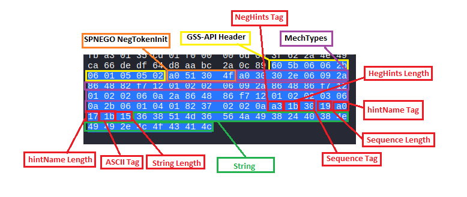

**Fase 2 - `SMB_COM_SESSION_SETUP_ANDX` Request, NTLMSSP_NEGOTIATE.** Il client risponde con un `mechTypes` ridotto al solo OID scelto, e nel `mechToken` (`0xa2`) inserisce l'**Octet String** (`0x04`) che contiene il primo pacchetto NTLM vero e proprio ([NTLM Type 1, \[MS-NLMP\]](https://learn.microsoft.com/en-us/openspecs/windows_protocols/ms-nlmp/b34032e5-3aae-4bc6-84c3-c6d80eadf7f2)), riconoscibile dalla firma `"NTLMSSP\0"` seguita dal Message Type `0x01000000` (NEGOTIATE) e dai flag di negoziazione.

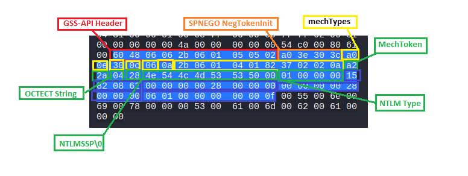

**Fase 3 - `SMB_COM_SESSION_SETUP_ANDX` Response, NTLMSSP_CHALLENGE.** Qui il tag cambia da `negTokenInit` a **`negTokenResp` (`0xa1`)**: l'header GSS-API (`0x60`) scompare perché il contesto è già stabilito. Dentro troviamo `negState` (`accept-incomplete`), `supportedMech` e `responseToken`, che contiene il pacchetto [NTLM Type 2, \[MS-NLMP\]](https://learn.microsoft.com/en-us/openspecs/windows_protocols/ms-nlmp/801a4681-8809-4be9-ab0d-61dcfe762786) con il **server challenge** (8 byte) e il **Target Info** con i dettagli del dominio/host del server.

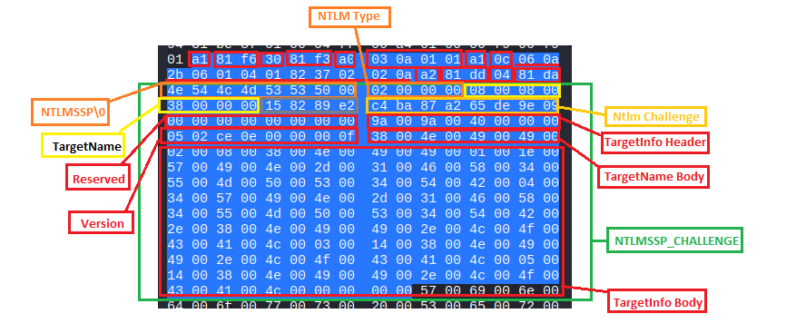

**Fase 4 - `SMB_COM_SESSION_SETUP_ANDX` Request, NTLMSSP_AUTH.** Il client chiude il giro con un `negTokenResp` contenente solo `responseToken`: al suo interno il pacchetto [NTLM Type 3, \[MS-NLMP\]](https://learn.microsoft.com/en-us/openspecs/windows_protocols/ms-nlmp/033d32cc-88f9-4483-9bf2-b273055038ce), con gli header per LM/NTLM Response, Domain, Username, Workstation, il **NTProofStr** (hash calcolato sulla challenge) e il **MIC**, seguiti dai valori effettivi delle stringhe ai rispettivi offset.

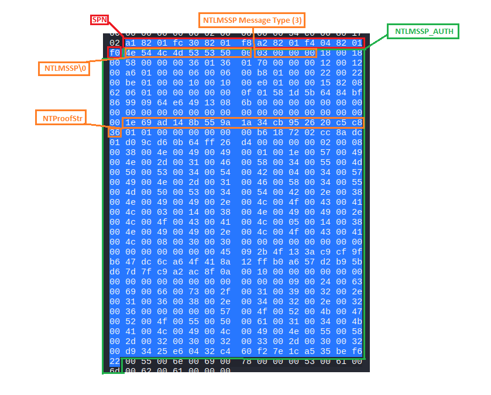

Per parsare questo ultimo livello (il pacchetto NTLM vero e proprio) ho scritto **[ntlm_parser](https://github.com/lcky00/ntlm_parser)**, che gestisce i tre tipi di messaggio (`NEGOTIATE`, `CHALLENGE`, `AUTH`) ed espone in modo strutturato username, dominio, hostname e la **NTLMv2 Response** con i relativi AV Pair (`NetBIOS domain name`, `NetBIOS computer name`, `DNS domain name`, timestamp, ecc.).

## 7. Il parser SMB1 e la catena completa

A monte di tutto, ovviamente, serve un parser del pacchetto SMB1 in sé: **[smb1_parser](https://github.com/lcky00/smb1_parser)** è un parser difensivo, scritto per estrarre il `security_blob` esattamente dai due comandi che interessano per l'autenticazione NTLM: `SMB_COM_NEGOTIATE` (`0x72`) e `SMB_COM_SESSION_SETUP_ANDX` (`0x73`). È volutamente **limitato a questi due comandi** e alla variante con extended security (il `WordCount` lo determina): non è un'implementazione generica del protocollo, è uno strumento mirato.

Messi in fila, i quattro parser formano una catena a strati che rispecchia esattamente il modello a cipolla visto prima:

```
bytes SMB1 → smb1_parser → security_blob
                              │
                              ▼
                         asn1_parser → asn1_tree_t
                              │
                              ▼
                      spnego_decoder → mechToken / responseToken (zero-copy)
                              │
                              ▼
                        ntlm_parser → username, domain, hostname, NTLMv2 Response
```

Un dettaglio su cui vale la pena soffermarsi è la gestione della memoria: dato l'approccio **zero-copy** di `spnego_decoder` (i puntatori interni puntano dentro l'`asn1_tree_t`, non a copie), l'ordine di `free()` è obbligato - prima i dati applicativi (es. `free_ntlm_msg`), poi la struttura SPNEGO, e **solo per ultimo** l'albero ASN.1. Liberare l'albero troppo presto significa invalidare tutti i puntatori a valle, con conseguente *use-after-free*.

## 8. Mettere tutto insieme: un server di validazione

Per verificare che tutta la catena di parsing funzionasse correttamente contro un client reale (e non solo contro buffer statici nei test), ho scritto **[impostor](https://github.com/lcky00/impostor)**: un server SMB1 che implementa, lato server, lo stesso scambio visto sopra, come **macchina a stati**.

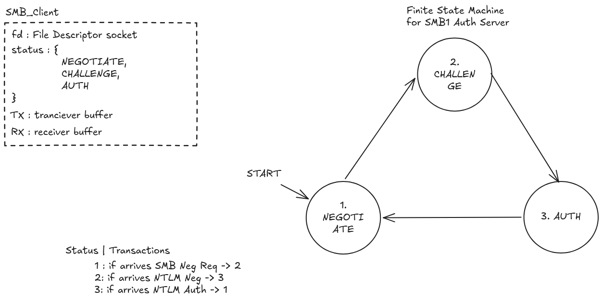

| Stato | Transizione |
|---|---|
| 1. `NEGOTIATE` | Arriva un `SMB_COM_NEGOTIATE` → il server risponde e passa a `2. CHALLENGE` |
| 2. `CHALLENGE` | Arriva un `NTLMSSP_NEGOTIATE` → il server risponde con la challenge e passa a `3. AUTH` |
| 3. `AUTH` | Arriva un `NTLMSSP_AUTH` → il server completa lo scambio e torna a `1. NEGOTIATE` |

Ogni connessione client è tracciata da una struttura di stato (`client_t`) che, oltre allo stato corrente, mantiene un buffer RX (dati ricevuti ma non ancora processati) e un buffer TX con relativo offset (dati da inviare ma non ancora trasmessi del tutto), più i campi per ricostruire l'header NetBIOS a 4 byte.

Il main loop è basato su `poll()`, per gestire più connessioni contemporaneamente senza bloccarsi:

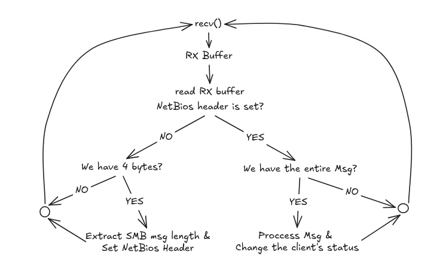

L'idea alla base è semplice ma va gestita con attenzione: alla ricezione si verifica di avere almeno i 4 byte dell'header NetBIOS, si estrae la lunghezza del messaggio SMB atteso, si bufferizza finché il messaggio non è completo, e solo a quel punto lo si passa alla catena di parsing (`smb1_parser` → `asn1_parser` → `spnego_decoder` → `ntlm_parser`) facendo avanzare lo stato del client.

> `impostor` è pensato come strumento per attività di red teaming/offensive security autorizzate e per lo studio del protocollo SMB1/NTLM, da usare esclusivamente in ambienti di cui si ha il controllo o con consenso esplicito.

## Conclusioni

Quello che inizialmente era "voglio capire come funziona NTLM su SMB1" è diventato uno studio completo che tocca trasporto (NetBIOS), formati binari (SMB1), codifiche a oggetti (ASN.1 DER), negoziazione (SPNEGO) e infine il protocollo di autenticazione vero e proprio (NTLMSSP) - il tutto validato scrivendo i parser da zero in C e un server che li mette alla prova contro un client reale.

## Fonti

Le specifiche ufficiali usate per questo studio:

- [\[MS-CIFS\]: Common Internet File System](https://learn.microsoft.com/en-us/openspecs/windows_protocols/ms-cifs) - struttura base di SMB1/CIFS
- [\[MS-SMB\]: Server Message Block Protocol](https://learn.microsoft.com/en-us/openspecs/windows_protocols/ms-smb) - estensioni NT LM 0.12 ed Extended Security
- [\[MS-SMB2\]: Server Message Block Version 2](https://learn.microsoft.com/en-us/openspecs/windows_protocols/ms-smb2/)
- [\[MS-NLMP\]: NT LAN Manager (NTLM) Authentication Protocol](https://learn.microsoft.com/en-us/openspecs/windows_protocols/ms-nlmp/)
- [RFC 4178 - The Simple and Protected GSS-API Negotiation Mechanism (SPNEGO)](https://datatracker.ietf.org/doc/html/rfc4178)
- [RFC 2743 - Generic Security Service Application Program Interface (GSSAPI)](https://datatracker.ietf.org/doc/html/rfc2743)
- Microsoft Learn, serie "About ASN.1": [Introduction to ASN.1 Syntax and Encoding](https://learn.microsoft.com/en-us/windows/win32/seccertenroll/about-introduction-to-asn-1-syntax-and-encoding), [Encoded Tag Bytes](https://learn.microsoft.com/en-us/windows/win32/seccertenroll/about-encoded-tag-bytes), [DER Transfer Syntax](https://learn.microsoft.com/en-us/windows/win32/seccertenroll/about-der-transfer-syntax), [Encoded Length and Value Bytes](https://learn.microsoft.com/en-us/windows/win32/seccertenroll/about-encoded-length-and-value-bytes), [DER Encoding of ASN.1 Types](https://learn.microsoft.com/en-us/windows/win32/seccertenroll/about-der-encoding-of-asn-1-types)

Le repo del progetto, se volete guardare il codice nel dettaglio:

- [smb1_parser](https://github.com/lcky00/smb1_parser) - parser del pacchetto SMB1
- [asn1_parser](https://github.com/lcky00/asn1_parser) - parser ASN.1 DER
- [spnego_decoder](https://github.com/lcky00/spnego_decoder) - decoder SPNEGO zero-copy
- [ntlm_parser](https://github.com/lcky00/ntlm_parser) - parser NTLMSSP
- [impostor](https://github.com/lcky00/impostor) - server SMB1 di validazione, a macchina a stati

Se avete domande o note su qualche passaggio, scrivetemi pure.
